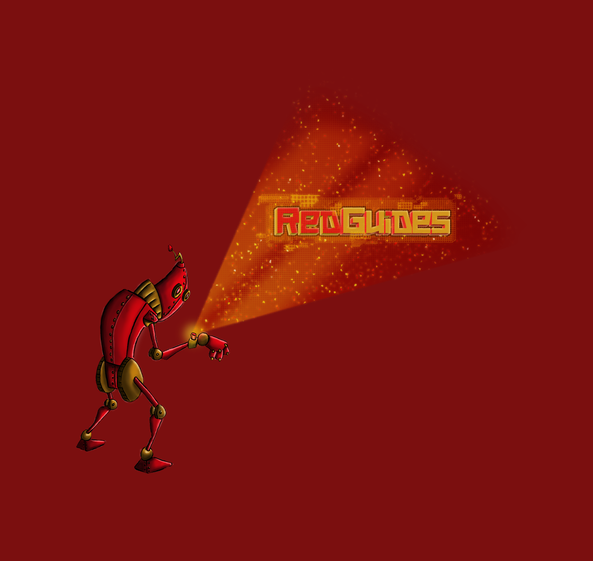
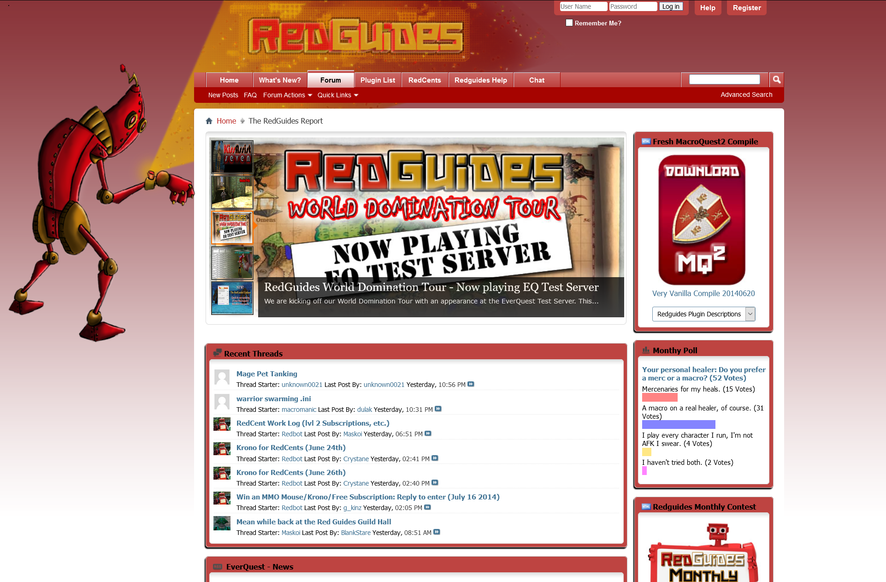

# Read📖Guides

<!-- Example of rotating images in the original wiki; listed here as Markdown images:
   
  
  
  
 -->

Read📖Guides for RedGuides™: when a manual needs more than a post.  
You'll find many more scripts and plugins under [resources on the forums](https://www.redguides.com/community/resources/), though none as handsomely documented as here. 

!!! tip "A short link to these docs: [readguides.com](https://readguides.com)"

---

## Docs Navigation

-   :material-bookshelf:{ .lg .middle } **[Reference](reference/index.md)**

    ---

    [All Commands](commands/index.md)
    [All TLOs](tlos/index.md)
    [All Data Types](datatypes/index.md)

    **Lookups:**
    [Spawn Search](projects/macroquest/reference/general/spawn-search.md)
    [SPA List](projects/macroquest/reference/general/spa-list.md)
    [Slot Names](projects/macroquest/reference/general/slot-names.md)
    [Skills](projects/macroquest/reference/general/skills-list.md)
    [Body Types](projects/macroquest/reference/general/body-types.md)
    [Animations](projects/macroquest/reference/general/animations.md)
    [Containers](projects/macroquest/reference/general/containers-list.md)
    [Languages](projects/macroquest/reference/general/languages.md)
    [Spawn Heights](projects/macroquest/reference/general/list-of-spawn-heights.md)

-   :material-console:{ .lg .middle } **[MacroQuest](projects/macroquest/index.md)**

    ---

    [Commands](projects/macroquest/reference/commands/README.md)
    [TLOs](projects/macroquest/reference/top-level-objects/README.md)
    [Data Types](projects/macroquest/reference/data-types/README.md)
    [MacroQuest.ini](projects/macroquest/main/macroquest.ini.md)

    **Features:**
    [Actors](projects/macroquest/main/features/actors.md)
    [Frame Limiter](projects/macroquest/main/features/framelimiter.md)
    [CFG Files](projects/macroquest/main/features/cfg-files.md)
    [Launcher](projects/macroquest/main/macroquest-launcher.md)

    **[Lua](projects/macroquest/lua/README.md):**
    [Actors](projects/macroquest/lua/actors.md)
    [Events and Binds](projects/macroquest/lua/events-and-binds.md)
    [Filtering Spawns](projects/macroquest/lua/getSpawns.md)
    [Saving Settings](projects/macroquest/lua/pickle.md)
    [LuaRocks](projects/macroquest/lua/luarocks-modules.md)
    [Macro to Lua](projects/macroquest/lua/macro-to-lua.md)

    **[Macros](projects/macroquest/macros/README.md):**
    [Getting Started](projects/macroquest/macros/getting-started.md)
    [Directives](projects/macroquest/reference/macro-directives/README.md)

-   :fontawesome-solid-dragon:{ .lg .middle } **[EverQuest](projects/everquest/index.md)**

    ---

    [Commands](projects/everquest/commands/index.md)
    [Configuration](projects/everquest/configuration.md)
    [Chat Variables](projects/everquest/general/chat-variables.md)

    **Short Names:**
    [Classes](projects/everquest/general/class-short-names.md)
    [Zones](projects/everquest/general/zone-short-names.md)
    [Servers](projects/everquest/general/server-short-names.md)

-   :material-puzzle:{ .lg .middle } **[Plugins](plugins/index.md)**

    ---

    **[Core](projects/macroquest/plugins/core-plugins/README.md):**
    [AutoLogin](projects/macroquest/plugins/core-plugins/autologin/index.md)
    [Map](projects/macroquest/plugins/core-plugins/map/README.md)
    [HUD](projects/macroquest/plugins/core-plugins/hud/README.md)
    [ItemDisplay](projects/macroquest/plugins/core-plugins/itemdisplay/README.md)
    [AutoBank](projects/macroquest/plugins/core-plugins/autobank/index.md)

    **Boxing:**
    [MQ2DanNet](projects/mq2dannet/index.md)
    [MQ2EQBC](projects/mq2eqbc/index.md)
    [MQRemote](projects/mqremote/index.md)
    [MQ2Boxr](projects/mq2boxr/index.md)
    [MQ2AutoGroup](projects/mq2autogroup/index.md)

    **Movement:**
    [MQ2Nav](projects/mq2nav/index.md)
    [MQ2EasyFind](projects/mq2easyfind/index.md)
    [MQ2MoveUtils](projects/mq2moveutils/index.md)
    [MQ2AdvPath](projects/mq2advpath/index.md)
    [MQActorFollow](projects/mqactorfollow/index.md)

    [All plugins](plugins/index.md)

-   :material-script-text-outline:{ .lg .middle } **[Scripts](scripts/index.md)**

    ---

    [Artisan's Prize](projects/artisansprize/index.md)
    [BoxHUD](projects/aqo/boxhud/README.md)
    [Chase](projects/aqo/chase/README.md)
    [Condition Builder](projects/aqo/condbuilder/README.md)
    [Event Manager](projects/aqo/lem/README.md)
    [Find Item Window](projects/aqo/find/README.md)
    [KissAssist](projects/kissassist/index.md)
    [Loot N Scoot](projects/aqo/lootnscoot/README.md)
    [Lua Expression Evaluator](projects/aqo/eval/README.md)
    [MAUI](projects/aqo/maui/README.md)

## Back to the Forums

!!! abstract "Quick Starts"
    • [Getting started with RedGuides and Very Vanilla MQ (new user guide)](https://www.redguides.com/community/threads/redguides-nfo.95805/)  
    • Staff are ready to help in the [Questions forum](https://www.redguides.com/community/forums/requests-and-questions.19/). *If you have a membership issue, [contact us here](https://www.redguides.com/community/misc/contact).*  

* [Forums](https://www.redguides.com/community/)  
    - [New posts](https://www.redguides.com/community/whats-new/)  
    - [General](https://www.redguides.com/community/forums/hail-a-fire-beetle.20/)  
    - [Questions](https://www.redguides.com/community/forums/requests-and-questions.19/)  
    - [Strategies](https://www.redguides.com/community/forums/strategies.17/)  
    * [Emulator forum](https://www.redguides.com/community/forums/eqemu-underground.95/)  
- [Resources](https://www.redguides.com/community/resources/)  
    - [Apps](https://www.redguides.com/community/resources/categories/apps-software.2/)  
    - [Macros](https://www.redguides.com/community/resources/categories/macros.8/)  
    - [Plugins](https://www.redguides.com/community/resources/categories/plugins.11/)  
    - [Lua scripts](https://www.redguides.com/community/resources/categories/lua.25/)  
- [Chat](https://www.redguides.com/community/rg-discord/)  
- [Membership](https://www.redguides.com/amember/)  
    - [Manage](https://www.redguides.com/amember/member)  
    - [Subscribe](https://www.redguides.com/everquest-multiboxing/)  
    - [Forgot password](https://www.redguides.com/amember/login?sendpass)  

---

## Add more docs

If there's a project that needs more than a post, please add it. Ask a moderator or visit the [ReadGuides git repository](https://github.com/RedGuides/readguides) for instructions.  